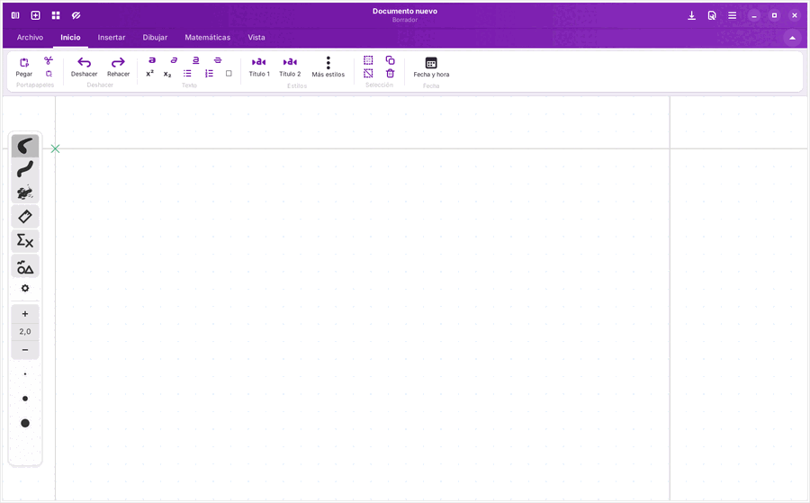
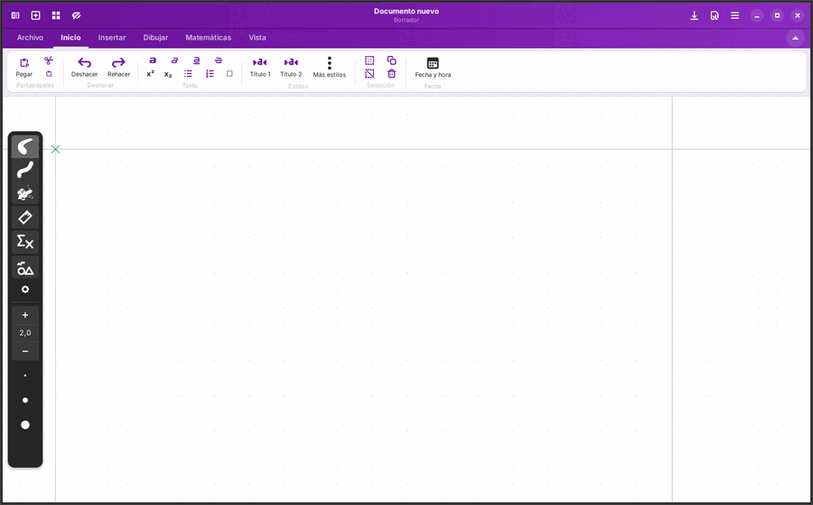
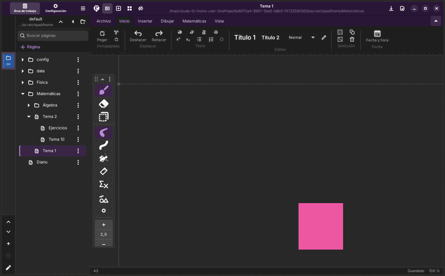
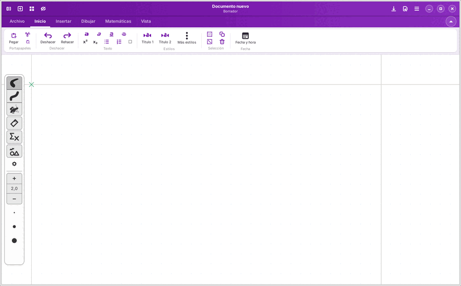
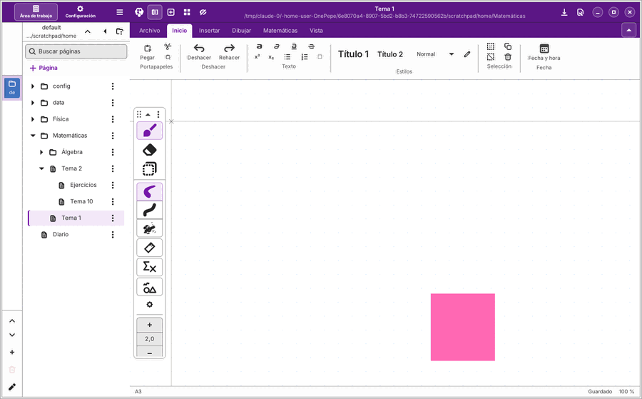

# Diseño de OnePepe

Este documento cuenta qué se hizo con tu guía «Plan de mejoras de diseño y guía para el agente de IA» (29/10/2026):
cómo está montado, capturas de antes y después, los contrastes medidos y lo que queda por probar en tu equipo.

Cómo se probó cada cosa:
- **Tests automáticos** en la nube.
- **App de prueba en la nube** (GTK 4.14 sobre una pantalla virtual, manejada con clics simulados).

Tu equipo usa GTK 4.22, así que algunos detalles pueden verse algo distintos. **Nada está probado con el lápiz real
todavía.**

## Antes y después

| | Antes | Después |
|---|---|---|
| Claro |  |  |
| Oscuro |  |  |
| Alto contraste |  |  |

**Antes, en oscuro,** solo cambiaba la barra de herramientas: la cinta, el lienzo y la cabecera seguían claros.
**Ahora** cambia todo a la vez.

Los cuadrados rosas de algunas capturas son trazos. La GTK 4.14 de la nube no sabe dibujarlos; es un fallo de esa
versión, no de OnePepe.

Más capturas:
- [Fondo y renglones](misc/onepepe/diseno/renglones.png): rayado de 7 mm con línea de margen.
- [Regla infinita](misc/onepepe/diseno/regla-infinita.png).
- [Ajustes → Apariencia](misc/onepepe/diseno/ajustes-apariencia.png).

## Cómo está montado el tema

- **Una sola tabla de colores** en `crates/rnote-ui/src/theme.rs`: los tokens de tu guía (`bg-canvas`, `fg-1`,
  `brand`…), con su valor en claro y en oscuro, y unos pocos ajustes para alto contraste.
  - De ella sale el CSS de cada tema, con colores `@op_*` que usa `data/style.css`.
  - También salen los colores de libadwaita, así que los botones y diálogos estándar siguen la misma paleta.
- **Sin colores sueltos:** un test falla si `style.css` tiene un color escrito a mano.
- **El cambio claro/oscuro:** lo avisa libadwaita, y la app recarga los colores y marca la ventana con la clase
  `dark` o `high-contrast`.
- **Sintaxis comprobada contra la versión de libadwaita** (lo pedía tu guía):
  - Los colores van con `@define-color`, que funciona en GTK 4.14 y en 4.22.
  - Las variables `var(--…)` de libadwaita 1.6 en adelante solo se escriben si tu GTK es 4.16 o más nueva; la 4.14
    las rechazaría con avisos.
  - Así se puede comprobar en la nube y en tu equipo queda completo.
- **Lienzo oscuro, solo en pantalla:**
  - Una matriz de color invierte la luminosidad y conserva el tono: el papel blanco se ve #292929, la tinta negra
    #E8E8E8 y un trazo rojo sigue siendo rojo, más claro.
  - Medido con un render real: blanco → (41, 41, 41), negro → (232, 232, 232), rojo → (255, 137, 137), azul →
    (200, 200, 255).
  - Los archivos y lo que exportas no cambian. Se puede apagar en Vista → «Lienzo oscuro».

## Contraste medido (WCAG 2)

Lo calcula un test (`theme.rs`, `contrast_of_the_themes`), que falla si alguna pareja baja del mínimo. Pasa en claro,
oscuro y alto contraste.

| Texto o control | Fondo | Mínimo | Claro | Oscuro |
|---|---|---|---|---|
| fg_1 | bg_canvas | 4.5:1 | 15.5:1 | 14.5:1 |
| fg_1 | bg_surface | 4.5:1 | 14.9:1 | 16.5:1 |
| fg_1 | bg_frame | 4.5:1 | 13.6:1 | 18.4:1 |
| fg_1 | bg_raised | 4.5:1 | 15.5:1 | 12.6:1 |
| fg_2 | bg_canvas | 4.5:1 | 10.0:1 | 10.0:1 |
| fg_2 | bg_surface | 4.5:1 | 9.6:1 | 11.3:1 |
| fg_2 | bg_raised | 4.5:1 | 10.0:1 | 8.7:1 |
| fg_2 | hover | 4.5:1 | 9.2:1 | 8.1:1 |
| fg_3 | bg_canvas | 4.5:1 | 6.2:1 | 6.5:1 |
| fg_3 | bg_surface | 4.5:1 | 5.9:1 | 7.3:1 |
| fg_3 | bg_raised | 4.5:1 | 6.2:1 | 5.6:1 |
| fg_1 | brand_tint | 4.5:1 | 13.1:1 | 13.8:1 |
| brand | brand_tint | 4.5:1 | 7.1:1 | 5.0:1 |
| brand | bg_canvas | 4.5:1 | 8.4:1 | 5.3:1 |
| brand | bg_raised | 4.5:1 | 8.4:1 | 4.6:1 |
| brand_hover | bg_raised | 4.5:1 | 10.9:1 | 6.1:1 |
| on_brand | brand | 4.5:1 | 8.4:1 | 6.0:1 |
| on_header | header | 4.5:1 | 11.0:1 | 16.5:1 |
| brand | bg_surface | 3:1 | 8.0:1 | 6.0:1 |
| canvas_cross | bg_canvas | 3:1 | 6.2:1 | 6.5:1 |

En oscuro, el texto de la marca sobre las superficies elevadas (`brand` sobre `bg_raised`) es el más justo: 4,6:1
para un mínimo de 4,5:1.

En alto contraste se refuerzan las líneas (`stroke-1` #616161 / #ADADAD) y el texto secundario. Los controles
activos llevan un borde visible.

## Qué hay de cada punto de la guía

| Punto | Hecho | Dónde |
|---|---|---|
| 1. Tokens y tema | Tabla única, claro/oscuro/alto contraste, colores de libadwaita, lienzo oscuro, test de colores sueltos y de contraste | `theme.rs`, `style.css` |
| 2. Cabecera, marca y cinta | Cabecera morada de 40 px con logo monocromo de 24 px; pestañas de 36 px (la activa se une a la cinta); cinta a todo lo ancho, sin marco, con una línea de 1 px; etiquetas de 12 px; activo en brand-tint; muestras de color redondas de 24 px; barra de estado de 24 px (hoja, páginas, guardado, zoom); logo tenue en el documento vacío; logo en Ajustes; selección y asas en color de marca (asas de 8 px); cruz del origen de 12 px gris y oculta por defecto; guías ocultas por defecto (Vista → Guías) | `statusbar.rs`, `ribbon.rs` |
| 3. Barra de opciones | La de la herramienta activa más 2–3 herramientas elegidas (por defecto pincel, borrador y selección); se arrastra arriba/abajo y al otro lado; se pliega; menú «Personalizar» (qué herramientas y en qué orden, lado automático/izquierda/derecha) | `optionsbar.rs` |
| 4. Bolis favoritos | 5 huecos con círculos de 28 px que muestran el trazo; anillo de marca en el activo; clic, mantener pulsado o «+», clic derecho (guardar aquí, mover, borrar), arrastrar para reordenar; Ctrl+1…Ctrl+5 | `favorites.rs` |
| 4. Estilos de texto | Título 1 (28/36, 600), Título 2 (22/30, 600) y Normal (16/24, 400), con vista previa en la cinta y Ctrl+Alt+1/2/0; se editan (lápiz junto a los estilos) y el texto que ya los usa cambia en los documentos abiertos | `textstyles.rs` |
| 5. Árbol | Cuaderno → secciones → páginas → subpáginas; filas de 32 px y sangría de 16 px; activa en brand-tint con barra de 3 px; arrastrar para ordenar o mover; menú (subir, bajar, convertir en subpágina, subir de nivel); buscar; «+ Página»; recuerda lo abierto; panel de 260 px o plegado a la barra de cuadernos | `workspacebrowser/tree.rs`, `onepepe_index.rs` |
| 6. Regla infinita | Línea que cruza el lienzo; marcas cada 8 px con números cada 80; banda de 24 px; giro de 15° en 15° con Mayús; se guarda por página | `ruler.rs` (compose y engine) |
| 6. Renglones | Tipo, separación (mm o px), grosor, colores, línea de margen; valores rápidos y con nombre; vista previa, restablecer; esta página o toda la sección | `lines.rs`, `onepepe_lines.rs` |
| 7. Ajustes | Siguen el tema; pestañas planas con subrayado (Lienzo y documento / Fondo y renglones / Entrada y lápiz / Atajos / Apariencia); filas de 48 px; logo; barra fija con Revertir y Aplicar | `settingslayout.rs` |
| 8. Capturas | Este documento | `misc/onepepe/diseno/` |

## Lo que cambió respecto a tu guía, y por qué

- **Atajos:**
  - Ctrl+1…Ctrl+5 eligen los bolis favoritos. Por eso las herramientas pasan a **Alt+1…Alt+6**.
  - Ctrl+Alt+1, Ctrl+Alt+2 y Ctrl+Alt+0 son los estilos de texto. Por eso los colores 1 y 2 de la paleta se quedan sin
    atajo (del 3 al 9 siguen con Ctrl+Alt).
- **Interlineado de los estilos:** el `.rnote` no guarda el interlineado de cada párrafo. El tamaño y el grosor sí se
  aplican; el interlineado es el de la letra. Los valores 36/30/24 de la guía se guardan en los ajustes por si algún
  día se puede usar.
- **«Cambiar un estilo cambia todo el texto que lo usa»:** se reconoce el texto de un estilo por su tamaño y grosor
  exactos.
  - Ventaja: no hace falta guardar nada aparte, y funciona también con páginas que vienen de Rnote.
  - Inconveniente: si escribiste a mano un texto con exactamente 28 y seminegrita, cuenta como Título 1.
- **Barra de opciones:** la guía pide 56 px de ancho. Las opciones del pincel de Rnote necesitan algo más, así que
  mide 56 px como mínimo.
- **Ajustes:** Rnote aplica cada ajuste al momento. Se mantiene así para no romper nada:
  - Ves el cambio en cuanto lo haces.
  - «Revertir» vuelve a como estaba al abrir los ajustes (o al último «Aplicar»), incluidos el tema y la
    configuración del documento abierto.
  - Si cierras sin aplicar, los cambios se quedan.
- **Motion:** las transiciones van entre 100 y 200 ms con salida suave. No tenía la tabla de curvas exacta, así que
  usé `ease-out`.

## No se ha podido probar en la nube

- **Arrastrar y soltar** (filas del árbol y bolis favoritos): está programado, pero el arrastre sintético de la nube no
  llega a empezar. Lo hecho con el menú (subir, bajar, subpáginas, mover favoritos) sí está probado.
- **GTK 4.22:** la parte de variables CSS de libadwaita 1.6+ solo se activa allí.
- **El lápiz real**, con todo lo anterior.

Lista de qué mirar en tu equipo: `ESTADO.md` → «Qué necesito de ti».
